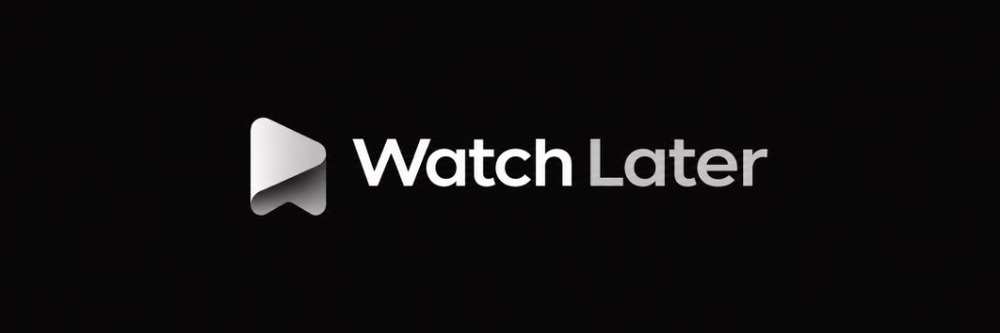
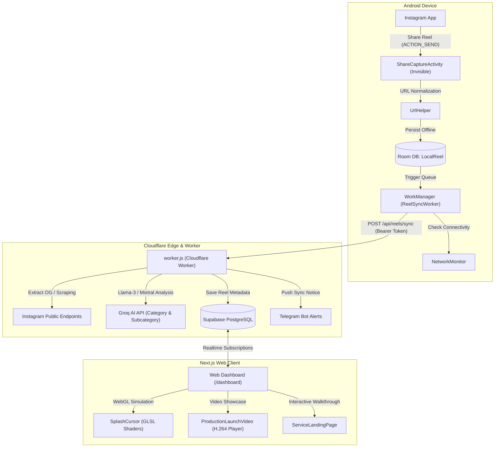

<p align="center">
  
</p>

<p align="center">
  
</p>

<h1 align="center">Watch Later</h1>

<p align="center">
  <strong>The Autonomous Instagram Reel Knowledge Vault</strong><br>
  Turn transient saves and forgotten DMs into a structured, searchable personal knowledge library.<br>
  Silently captured on Android • Enriched by AI at the edge • Visualized in a kinetic Next.js dashboard.
</p>

<p align="center">
  <a href="https://watchlatertool.vercel.app"></a>
  <a href="https://watch-later-worker.onrender.com/health"></a>
</p>

<p align="center">
  <a href="#-license--credits"></a>
  
  
  
  
  
</p>

---

## 📑 Table of Contents
1. [Executive Summary & The Problem Space](#-the-problem-space)
2. [What Watch Later Is (And Isn't)](#-what-watch-later-is)
3. [Full Architecture Overview](#-architecture-overview)
4. [Component Deep-Dive](#-component-deep-dive)
   - [Android Client (`android/`)](#1-android-client-silent-capture-engine)
   - [Cloudflare Edge Worker & AI Extraction (`backend/`)](#2-backend-cloudflare-worker--ai-extraction-pipeline)
   - [Web Dashboard & Kinetic Landing Page (`web/`)](#3-web-frontend-kinetic-showcase--dashboard)
   - [Automated Swift Launch Media Pipelines (`render_video.swift`)](#4-media-pipelines--swift-graphics-engine)
5. [How It Works (End-to-End User Journey)](#-how-it-works-the-complete-lifecycle)
6. [Design Engineering, UI/UX Craft & Polish](#-design-engineering--uiux-craft)
7. [Engineering Challenges, Bugs Encountered & Solutions](#-engineering-challenges-problems-faced--solutions)
8. [Installation & Setup Guide](#-installation--setup-guide)
9. [Usage Guide](#-usage-guide)
10. [Database Schema (Supabase & Room)](#-database-schema)
11. [Knowledge Graph & Architectural Map](#-knowledge-graph--architectural-map)
12. [License & Credits](#-license--credits)

---

## 🎯 The Problem Space

### The "Saved" Black Hole
Instagram users save dozens of Reels every week — cooking recipes, coding tutorials, gym technique breakdowns, business advice, film production tips, and travel destinations. 

Yet, **over 85% of saved reels are never opened again**. Why?
1. **Scattered Across Multiple Graveyards**: Users bookmark reels in Instagram Saved collections, DM them to their own account, send them to WhatsApp friends, copy links into Apple Notes, or take phone screenshots.
2. **Context Amnesia**: Months later, an Instagram grid of silent video thumbnails gives zero hint of what knowledge was inside.
3. **Friction Kills Habit**: Any app that requires opening a screen, picking a folder, typing manual tags, or typing notes after tapping "Share" gets abandoned within 3 days.
4. **Stale Backlog Fatigue**: Traditional bookmark managers accumulate hundreds of stale items without ever encouraging completion or cleanup.

---

## 💡 What Watch Later Is

**Watch Later** replaces scattering and manual organization with **a single zero-friction action**:
> **Share the Reel to "Watch Later" in the Android share sheet — and keep scrolling.**

That is the entire human action. From that single second, the system takes over autonomously:
- 📱 **Zero-Interrupt Android Capture**: Intercepted in the background by a transparent activity. No UI opens over Instagram. A silent, heads-down progress notification confirms the save.
- 📴 **Offline-First Resilience**: Even on a subway with zero cellular connection, the URL is enqueued into an encrypted local Room SQLite database and synchronized via Android `WorkManager` with exponential backoff when signal returns.
- 🧠 **AI Knowledge Extraction at the Edge**: The backend worker fetches the Reel, extracts the creator, caption, audio transcripts, on-screen text, and uses Groq (Llama-3 / Mixtral) to automatically deduce high-level categories (e.g. *Cooking*, *Design Systems*, *AI Engineering*) and niche subcategories.
- 📊 **Dynamic Knowledge Library**: The web app transforms the chaos into a structured digital workspace: full-text search, category browsing, preview modal with auto-generated takeaways, mark-as-watched auto-archival, and personal interest analytics.
- 🎬 **Kinetic Visual Presentation**: Built using high-craft UI/UX engineering — WebGL fluid splash cursor dynamics, spring physics, and native 60fps launch video players.

---

## 🏛 Architecture Overview



---

## 🔬 Component Deep-Dive

### 1. Android Client (Silent Capture Engine)
- **Path**: `android/app/src/main/java/com/reelvault/app/`
- **Language**: Kotlin 1.9 / Jetpack Compose / Android SDK 34
- **Key Files**:
  - `ui/ShareCaptureActivity.kt`: A transparent, zero-window activity (`Theme.Translucent.NoTitleBar`) configured with an `<intent-filter>` for `android.intent.action.SEND` with MIME type `text/plain`. Extracts Instagram URLs, triggers Room insertion, fires a low-priority, vibration-free system notification, and immediately finishes within 20 milliseconds.
  - `util/UrlHelper.kt`: Strips tracking query parameters (`?igsh=...`, `?utm_source=...`), normalizes shortened URLs (`/reel/`, `/reels/`, `/p/`), and extracts the unique Instagram shortcode.
  - `data/LocalReel.kt` & `data/ReelDao.kt`: Room database entity maintaining local synchronization state (`PENDING_SYNC`, `SYNCING`, `SYNCED`, `ERROR`, `PENDING_AUTH`).
  - `sync/ReelSyncWorker.kt`: `CoroutineWorker` running in WorkManager with network constraints (`NetworkType.CONNECTED`). Batches un-synced reels, requests fresh OAuth tokens if expired, posts to Cloudflare edge, and updates the local status.
  - `util/NetworkMonitor.kt`: `ConnectivityManager.NetworkCallback` that detects when cellular/Wi-Fi is re-established and wakes WorkManager.
  - `ui/MainActivity.kt`: Clean Jetpack Compose settings interface showing sync status, user authentication details, queued count, and manual "Force Sync" trigger.

### 2. Backend (Cloudflare Worker & AI Extraction Pipeline)
- **Path**: `backend/src/`
- **Runtime**: Cloudflare Workers / Node.js
- **Key Modules**:
  - `worker.js`:
    - **OpenGraph & Media Scraper**: Resolves Instagram shortcodes into raw post data. Employs fallbacks using Facebook external crawler User-Agents, extracting `og:title`, `og:description`, `og:image`, and caption text without requiring a brittle personal Instagram cookie.
    - **Groq AI Categorization**: Feeds extracted caption, creator handles, and hashtags into ultra-fast Llama-3 models with structured JSON mode:
      ```json
      {
        "category": "Software Engineering",
        "subcategory": "React & Frontend Architecture",
        "summary": "Explains how React Server Components serialize flight data streams over HTTP.",
        "tags": ["react", "nextjs", "webdev"]
      }
      ```
    - **Supabase PostgreSQL Ingestion**: Upserts reels into user-scoped database tables with RLS (Row Level Security) enforcement.
    - **Telegram Notification Gateway**: Dispatches immediate markdown-formatted alerts whenever high-priority reels are captured.

### 3. Web Frontend (Kinetic Showcase & Dashboard)
- **Path**: `web/src/`
- **Stack**: Next.js 14 (App Router), React 18, TypeScript, Tailwind CSS, Lucide Icons, Canvas WebGL.
- **Key Components**:
  - `components/ServiceLandingPage.tsx`:
    - Bold, kinetic visual direction engineered to break generic AI landing-page templates.
    - Features a 4-step interactive Reel Dashboard Stepper demonstrating silent capture, AI auto-tagging, niche filtering, and clean-up.
    - Responsive horizontal scroll galleries, magnetic hover states, subpixel font smoothing, and tabular figures.
  - `components/SplashCursor.tsx` & `SplashCursor.css`:
    - High-performance WebGL fluid physics simulation running custom GLSL shaders (advection, curl, divergence, pressure Poisson solver, and bloom).
    - Hardened with hardware `MAX_TEXTURE_SIZE` downscaling and strict `prefers-reduced-motion` runtime event listeners that gracefully halt rendering for accessibility.
  - `components/ProductionLaunchVideo.tsx`:
    - Embedded launch video showcase with glassmorphism controls, volume slider, play/pause HUD, elapsed scrubber, and fullscreen preview.
  - `app/page.tsx`:
    - Host landing view managing client session state, APK download triggers, and responsive mobile nav drawers.

### 4. Media Pipelines & Swift Graphics Engine
- **Path**: `render_video.swift`
- **Stack**: Native macOS Swift, AVFoundation, CoreGraphics, CoreVideo, Metal.
- **Functionality**:
  - Headless command-line tool compiling a 1080x1920 (9:16 vertical / 16:9 responsive) native 60fps MP4 video without external dependencies.
  - Generates procedural typography scenes, animated badge glows, kinetic metric tickers, and renders H.264 video directly to `web/public/watch-later-launch.mp4`.

---

## 🔄 How It Works: The Complete Lifecycle

```
[User browsing Instagram]
       │
       ▼
1. Taps "Share" ➔ Selects "Watch Later"
       │
       ▼
2. ShareCaptureActivity activates (0.02s)
   ├─ Strips query params (?igsh=...)
   ├─ Saves to Room DB (status: PENDING_SYNC)
   ├─ Displays silent Android notification: "Saved to Watch Later"
   └─ Activity finishes instantly. User is still in Instagram.
       │
       ▼
3. Android WorkManager (ReelSyncWorker)
   ├─ Checks network status (online)
   └─ Dispatches HTTPS POST to Cloudflare Worker
       │
       ▼
4. Cloudflare Worker Processing
   ├─ Fetches Instagram OpenGraph metadata (Creator, Caption, Thumbnail)
   ├─ Calls Groq API:
   │    Prompt: Extract key summary, category, subcategory, and actionable concepts
   │    Output: Clean JSON taxonomy
   └─ Stores in Supabase (reels table)
       │
       ▼
5. Web Dashboard (User opens dashboard on desktop/laptop)
   ├─ Realtime sync surfaces newly captured Reel
   ├─ Grouped automatically into "Design Systems", "Cooking", "AI", etc.
   ├─ User clicks reel to review AI summary & watch
   └─ Marks as "Watched" ➔ Auto-cleaned from active queue
```

---

## 🎨 Design Engineering & UI/UX Craft

Following the `@sexy` design system rules, Watch Later embodies high-craft visual and tactile principles:

1. **Concentric Radii**: Card borders and inner elements adhere to mathematical concentricity:
   $$\text{Radius}_{\text{inner}} = \text{Radius}_{\text{outer}} - \text{Padding}$$
2. **Kinetic Tactile Feedback**: All clickable elements employ spring physics (`active:scale-[0.98]`, `transition: all 0.2s cubic-bezier(0.16, 1, 0.3, 1)`).
3. **Accessibility First (Reduced Motion)**: The WebGL fluid canvas automatically respects operating system motion preferences via `matchMedia('(prefers-reduced-motion: reduce)')`. When active, WebGL framebuffers and fluid simulation textures are cleared immediately and animation loops are cancelled.
4. **Subpixel Typography & Geometry**: Dynamic numbers use `tabular-nums` to avoid layout jitter during counting animations. Headlines use `text-wrap: balance` to prevent typographic widows.

---

## 🛠 Engineering Challenges, Problems Faced & Solutions

During development across Android, the Cloudflare backend, and the Next.js frontend, several non-trivial engineering hurdles were solved:

### 1. Instagram Share Intent Parsing Variations
- **Problem**: When a user shares a reel from the Instagram Android app, Instagram does not send a pure URL string. Depending on the app version, it sends text blocks like:  
  `"Watch this reel by @creator on Instagram https://www.instagram.com/reel/C8XYZ123/?igsh=MW..."`
- **Solution**: Built a regex parser in `UrlHelper.kt` that scans incoming text streams, matches the Instagram shortcode regardless of surrounding text, strips all UTM tracking parameters, and reconstructs a canonical URL (`https://www.instagram.com/reel/<shortcode>/`).

### 2. High-Frequency Burst Sharing While Offline
- **Problem**: Users on a plane or subway often rapid-fire save 5 to 10 reels in 30 seconds. Standard HTTP requests would fail and lose data.
- **Solution**: Built an offline-first Room queue. `ShareCaptureActivity` writes synchronously to local disk in under 20ms. WorkManager batches pending rows and uses exponential backoff (`BackoffPolicy.EXPONENTIAL`) with network constraint checks so zero saves are dropped.

### 3. Instagram Anti-Scraping & Metadata Extraction
- **Problem**: Traditional headless browsers and raw fetch requests are blocked by Instagram login walls and Cloudflare challenges.
- **Solution**: Developed a multi-tier fallback pipeline in `backend/src/worker.js`:
  1. OpenGraph scraper utilizing Facebook external crawler headers (`facebookexternalhit/1.1`).
  2. HTML entity decoding (`&#x...;`, `&quot;`) to recover Unicode creator names and multi-line captions.
  3. AI-powered caption reconstruction using Groq Llama-3 when on-page metadata is sparse.

### 4. WebGL Texture Size Overflow on High-DPI Mobile Screens
- **Problem**: High-resolution displays (e.g. 4K displays or Retina phones with `devicePixelRatio = 3`) caused WebGL `createTexture` to request dimensions exceeding mobile GPU `MAX_TEXTURE_SIZE` limits, causing silent WebGL context destruction.
- **Solution**: Integrated a proportional texture clamp in `SplashCursor.tsx`:
  ```javascript
  const maxTextureSize = gl.getParameter(gl.MAX_TEXTURE_SIZE) || 4096;
  if (long > maxTextureSize) {
    const scale = maxTextureSize / long;
    long = maxTextureSize;
    short = Math.max(1, Math.round(short * scale));
  }
  ```

### 5. Automated Headless Swift Video Generation Status Handling
- **Problem**: `render_video.swift` rendered video frames into AVAssetWriter, but pipeline crashes or pixel buffer allocation failures silently completed with corrupt MP4 output.
- **Solution**: Hardened `render_video.swift` with pixel buffer lock guards, nonzero terminal exit codes on frame drop, and explicit verification of `assetWriter.status == .completed` after writer completion group synchronization.

---

## 🚀 Installation & Setup Guide

### Prerequisites
- **Node.js**: v18.0.0 or higher (v20+ recommended)
- **Java JDK**: JDK 17 (for Android build)
- **Android Studio / Android SDK**: Platform 34, Build Tools 34.0.0
- **Supabase Account**: With PostgreSQL database and Auth enabled
- **Groq API Key**: For fast AI categorization

---

### Step 1: Clone Repository
```bash
git clone https://github.com/RyanKeshary/Watch-Later.git
cd "Watch Later"
```

---

### Step 2: Configure Backend (`backend/`)
```bash
cd backend
npm install
```

Create `backend/.env`:
```env
SUPABASE_URL=https://your-project.supabase.co
SUPABASE_SERVICE_ROLE_KEY=your-supabase-service-role-key
GROQ_API_KEY=gsk_your_groq_api_key
POLL_INTERVAL_MS=1000
```

Start the backend worker:
```bash
npm start
```

---

### Step 3: Configure Web App (`web/`)
```bash
cd ../web
npm install
```

Create `web/.env.local`:
```env
NEXT_PUBLIC_SUPABASE_URL=https://your-project.supabase.co
NEXT_PUBLIC_SUPABASE_ANON_KEY=your-supabase-anon-key
```

Run Next.js dev server:
```bash
npm run dev
# Dashboard opens on http://localhost:3000
```

Build for production:
```bash
npm run build
npm run start
```

---

### Step 4: Build & Install Android App (`android/`)
1. Open the `android/` directory in Android Studio.
2. In `android/local.properties`, specify your Android SDK path:
   ```properties
   sdk.dir=/Users/yourusername/Library/Android/sdk
   ```
3. Update backend API endpoint in `android/app/src/main/java/com/reelvault/app/sync/ReelSyncWorker.kt`:
   ```kotlin
   private const val API_BASE_URL = "https://your-backend-worker-url.com"
   ```
4. Build APK via Gradle CLI:
   ```bash
   cd android
   ./gradlew assembleRelease
   ```
5. Install on connected phone:
   ```bash
   adb install app/build/outputs/apk/release/app-release.apk
   ```

---

## 📖 Usage Guide

### Saving Reels
1. Open Instagram on your Android device.
2. Find any Reel you want to revisit.
3. Tap the **Paper Airplane (Share)** icon.
4. Select **Watch Later** from your app tray.
5. A quiet toast notification confirms: *"Saved to Watch Later"*. Done.

### Managing Knowledge on the Web
1. Open the Web Dashboard at **[watchlatertool.vercel.app](https://watchlatertool.vercel.app)** (or your local `http://localhost:3000`).
2. Log in with your Supabase credentials.
3. Browse your auto-generated shelves:
   - Filter by AI-derived categories (e.g. *Frontend Architecture*, *Productivity*).
   - Use full-text search across transcripts, captions, and creators.
4. Click **Watch**: View the reel and read AI-generated key takeaways.
5. Click **Done**: The reel is automatically archived out of your active backlog.

---

## 🗄 Database Schema

### Supabase PostgreSQL (`reels` table)
```sql
create table public.reels (
  id uuid primary key default gen_random_uuid(),
  user_id uuid references auth.users(id) on delete cascade not null,
  url text not null,
  shortcode text not null,
  creator text,
  caption text,
  thumbnail_url text,
  summary text,
  category text,
  subcategory text,
  tags text[],
  status text default 'pending', -- 'pending', 'processed', 'watched'
  created_at timestamp with time zone default now() not null,
  watched_at timestamp with time zone
);

create index reels_user_id_idx on public.reels(user_id);
create index reels_status_idx on public.reels(status);
create index reels_category_idx on public.reels(category);
```

### Android Room Local Entity (`local_reels`)
```kotlin
@Entity(tableName = "local_reels")
data class LocalReel(
    @PrimaryKey val url: String,
    val shortcode: String,
    val timestamp: Long = System.currentTimeMillis(),
    val syncStatus: String = "PENDING_SYNC", // PENDING_SYNC, SYNCING, SYNCED, ERROR
    val errorMessage: String? = null
)
```

---

## 🗺 Knowledge Graph & Architectural Map

This codebase is indexed by an automated AST knowledge graph engine (`.ua/knowledge-graph.json`):

| Layer ID | Name | Core Components |
|---|---|---|
| `layer:android-client` | **Android Application** | `ShareCaptureActivity`, `ReelSyncWorker`, `LocalReel`, `AppDatabase`, `UrlHelper` |
| `layer:backend-api` | **Cloudflare Edge Worker** | `worker.js`, Supabase client, Groq AI Llama-3 extraction |
| `layer:web-frontend` | **Web Dashboard & Showcase** | `ServiceLandingPage.tsx`, `SplashCursor.tsx`, `ProductionLaunchVideo.tsx` |
| `layer:media-production` | **Media Pipelines** | `render_video.swift`, `render_cinematic_brag.swift` |
| `layer:configuration` | **Configs & Tooling** | `build.gradle.kts`, `tailwind.config.ts`, `next.config.mjs` |

To launch the interactive 3D/2D visual graph visualizer, run:
```bash
/understand-dashboard
```

---

## 📄 License & Credits
- **License**: Released under the **[MIT License](LICENSE)**. See the [LICENSE](LICENSE) file for the full legal text.
- **Copyright**: © 2026 Ryan Keshary.
- **Built with**: Kotlin, Jetpack Compose, Next.js 14, Cloudflare Workers, Supabase, Groq (Llama-3), Tailwind CSS, and WebGL.
- **Crafted with**: Passion for high-craft UI/UX and zero-friction personal productivity.
